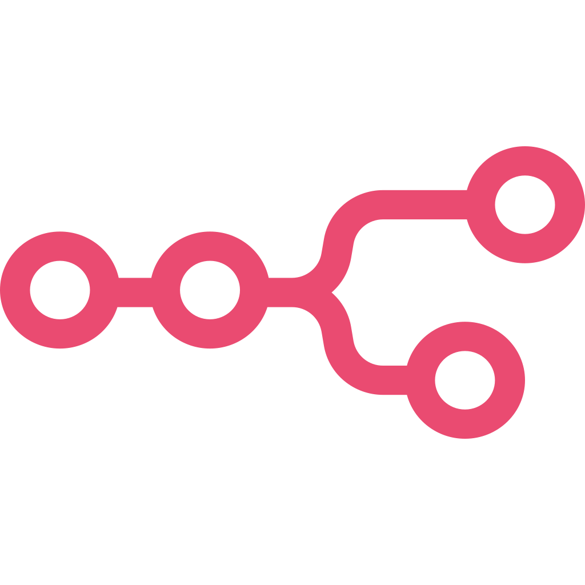
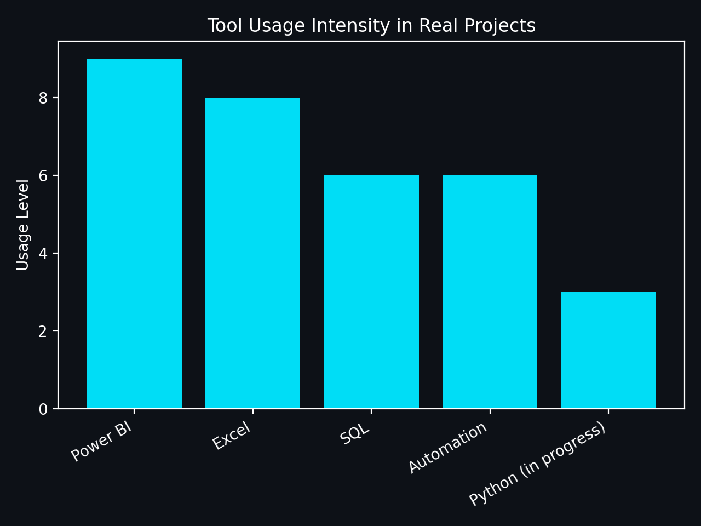
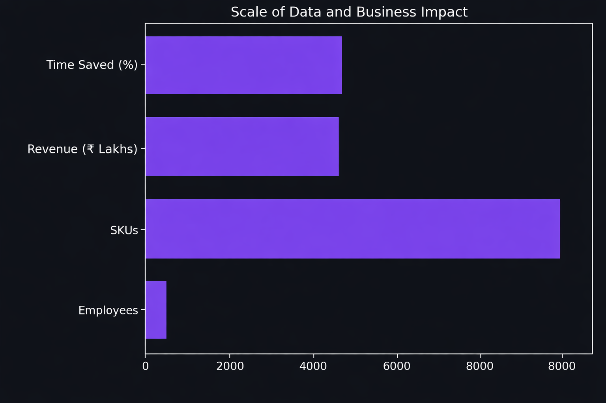
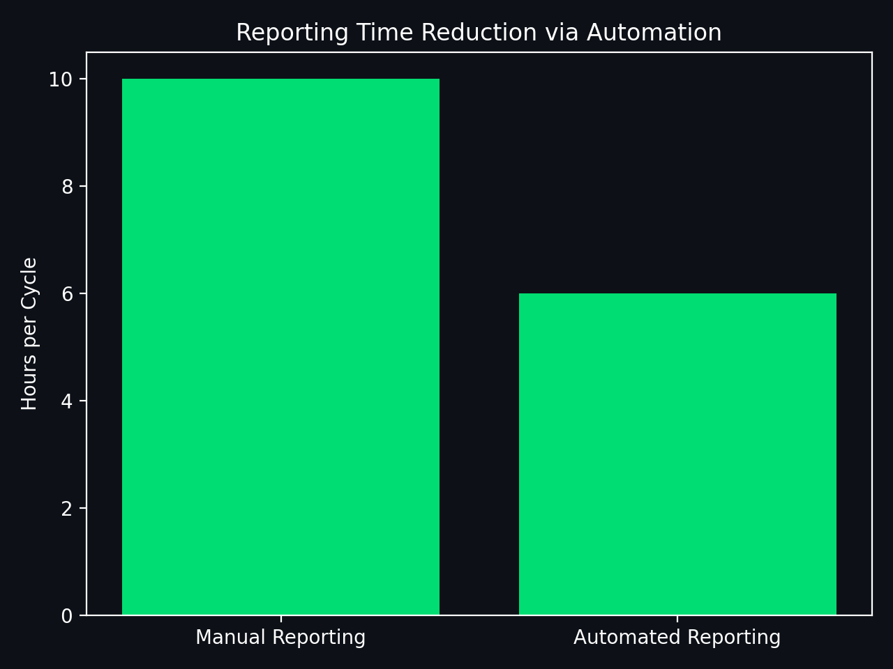
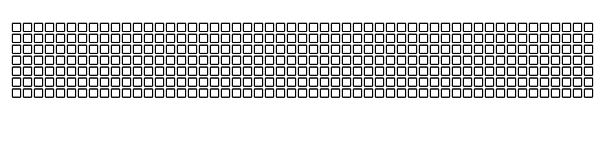

<!-- Deep-space / abyssal gradient banner -->

<!-- Typing animation -->

<!-- Waving hand GIF -->

  

  
  
  

---

### 🧬 About Me

<table width="100%">
<tr>
<td width="50%" valign="top">

**📊 Modern MIS & Data Analytics**
- Turning raw operational data into decision-ready KPIs & MIS dashboards
- Skilled in Power BI, SQL, PostgreSQL, Tableau & Excel automation
- Analysed 500+ employees and 9,000+ SKUs to uncover business drivers
- Combining domain logic with AI-assisted workflows for rapid insights

</td>
<td width="50%" valign="top">

**⚡ AI Automation & Vibe Coding**
- Modern Data Analyst @ **May Integrated Service LLP**
- Vibe coding full-stack apps & pipelines using Next.js, Supabase & n8n
- Automating **90% of manual, unsystematic workflows** to cut turnaround time
- Architected and shipped **2 production automation systems** end-to-end

</td>
</tr>
</table>

---

### 🛠️ Tech Stack

**Data & Analytics**

**AI & Automation**

**Full-Stack & Vibe Coding**

---

### 🚀 Featured Projects

| Project | Business Impact |
|---|---|
| **HR Attrition Analytics** | Identified overtime as the driver of 66% attrition; cut reporting time by 40% |
| **Sales Performance Dashboard** | Automated revenue, margin, growth & variance tracking across periods |
| **Blinkit E-commerce Analytics** | Analysed ₹1.20M revenue across 9,000 SKUs to optimise inventory mix |

<!--
Uncomment and place at the top of the table once you add your two automation systems:
| **[System Name 1](link)** | Replaced manual [process] with a Next.js + Supabase workflow, cutting effort by X% |
| **[System Name 2](link)** | Automated [workflow] end-to-end, saving X hours/week across teams |
-->

---

### 📈 Visual Snapshots

  
  
  

---

### 📊 GitHub Analytics

  
  

  

---

### 🐍 Contribution Activity

  

---

  
  ⚡ Built with data, automated with AI, deployed with intent.

